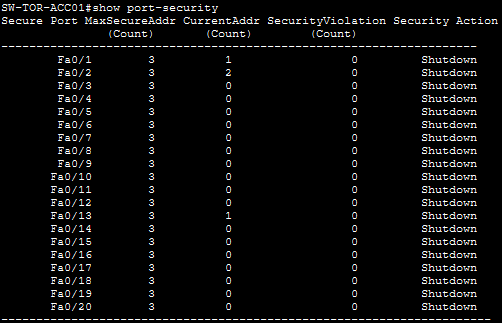
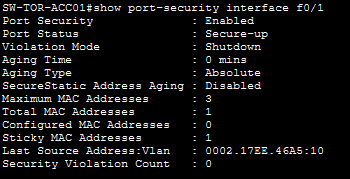
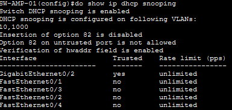
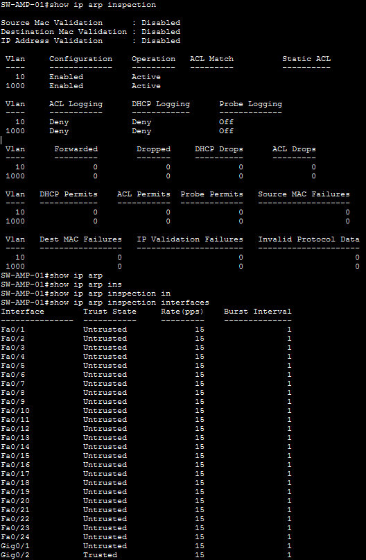

# 07 - Seguridad

## 7.1 Objetivo

Esta sección documenta los mecanismos de seguridad configurados en el laboratorio de red empresarial. El enfoque se centra en proteger los puertos de acceso, limitar la administración remota y reducir ciertos riesgos asociados al tráfico de capa 2.

Las medidas descritas se basan en las configuraciones y salidas de verificación disponibles. Cuando una función aparece configurada pero no operativa en la evidencia, se indica expresamente para no presentar como efectiva una protección que todavía requiere validación.

## 7.2 Resumen de medidas de seguridad

| Mecanismo | Equipo o ámbito | Objetivo | Estado según la evidencia |
|---|---|---|---|
| SSH | Routers y switches | Administración remota cifrada | Configurado en el laboratorio |
| ACL en líneas VTY | Routers y switches | Restringir desde qué redes se puede administrar | Configurado |
| Port Security | `SW-TOR-ACC01` | Limitar las direcciones MAC aprendidas en puertos de acceso | Habilitado en los puertos mostrados |
| Sticky MAC | `SW-TOR-ACC01` | Aprender y fijar dinámicamente direcciones MAC seguras | Evidenciado en `Fa0/1` |
| Modo de violación `Shutdown` | `SW-TOR-ACC01` | Deshabilitar el puerto ante una violación | Configurado |
| PortFast y BPDU Guard | Puertos de acceso | Agilizar la conexión de equipos finales y proteger frente a BPDUs inesperadas | Incluidos en el diseño; validar por interfaz |
| DHCP Snooping | `SW-AMP-01` | Distinguir puertos DHCP confiables y no confiables | Habilitado; tabla de bindings vacía en la captura |
| PortFast y BPDU Guard | Puertos de acceso | Agilizar la conexión de equipos finales y proteger frente a BPDUs inesperadas | Incluidos en el diseño; evidencia por interfaz pendiente |
| DHCP Snooping | `SW-AMP-01` | Distinguir puertos DHCP confiables y no confiables | Habilitado; bindings registrados tras corregir Option 82 |
| Dynamic ARP Inspection | `SW-AMP-01` | Validación de tráfico ARP | Configurado y operativo (`Active`) |

## 7.3 Administración segura mediante SSH y ACL

Los equipos de red se administran mediante SSH en lugar de depender de Telnet. SSH cifra la sesión de administración, incluidas las credenciales transmitidas durante el acceso.

El acceso a las líneas VTY se restringe mediante ACL:

- En Tortosa, la administración se limita a la VLAN `ADMIN`, red `192.168.1.0/26`.
- En las otras sedes, el acceso administrativo se limita a la LAN local correspondiente.

Este enfoque limita el acceso administrativo a los orígenes necesarios. La ACL de VTY no sustituye a la autenticación, a la gestión segura de credenciales ni a la actualización de los dispositivos.

**Verificación recomendada:**

```text
show running-config
show access-lists
```

Revisar las líneas VTY, el método de transporte permitido, la autenticación y la ACL aplicada. La salida debe demostrar que SSH está permitido y que Telnet no queda habilitado de forma innecesaria.

## 7.4 Port Security

Port Security limita las direcciones MAC que pueden utilizar un puerto de acceso.

En `SW-TOR-ACC01`, la salida de `show port-security` muestra puertos con un máximo de tres direcciones MAC seguras y acción de violación `Shutdown`.

La salida de `show port-security interface f0/1` confirma:

```text
Port Security              : Enabled
Port Status                : Secure-up
Violation Mode             : Shutdown
Maximum MAC Addresses      : 3
Sticky MAC Addresses       : 1
Security Violation Count   : 0
```

Para `Fa0/1` se observa Port Security habilitado, una dirección MAC sticky aprendida, un máximo de tres direcciones seguras y cero violaciones registradas en la captura. La tabla global también muestra cero violaciones en los puertos listados. Esto describe el estado observado, no demuestra que nunca haya ocurrido una violación.

Con el modo `Shutdown`, una violación puede llevar la interfaz a estado err-disabled. Si ocurre, debe revisarse la MAC detectada, comprobar si el dispositivo conectado está autorizado y recuperar el puerto siguiendo el procedimiento definido para el laboratorio.

**Verificación:**

```text
show port-security
show port-security interface f0/1
show interfaces status
```





## 7.5 Sticky MAC

Sticky MAC permite que el switch aprenda direcciones MAC dinámicamente y las trate como direcciones seguras sticky.

La evidencia para `SW-TOR-ACC01 Fa0/1` muestra:

```text
Sticky MAC Addresses       : 1
Configured MAC Addresses   : 0
Total MAC Addresses        : 1
```

La dirección segura observada se ha aprendido mediante sticky MAC y no aparece como una dirección segura configurada manualmente en esa interfaz.

El aprendizaje sticky facilita el despliegue inicial, pero hay que revisar qué dispositivos están conectados antes de guardar la configuración. De lo contrario, una dirección aprendida de un equipo no autorizado podría persistir en la configuración.

## 7.6 PortFast y BPDU Guard

PortFast permite que un puerto de acceso pase rápidamente al estado de reenvío. BPDU Guard protege el puerto cuando recibe una BPDU inesperada, situación que puede indicar que se ha conectado un switch donde no corresponde.

Estas funciones deben aplicarse a puertos destinados a equipos finales, no indiscriminadamente a enlaces entre switches ni a enlaces agregados.

El diseño contempla estas protecciones. Sin embargo, las evidencias disponibles no incluyen una salida específica que confirme su estado en cada interfaz. Por ello, se recomienda verificarlo antes de afirmar que todos los puertos de acceso están protegidos.

**Verificación recomendada:**

```text
show running-config
show spanning-tree summary
show spanning-tree interface fa0/1 detail
```

Revisar cada interfaz para confirmar PortFast y BPDU Guard, y comprobar que los enlaces entre switches y los EtherChannel no se han tratado como puertos de usuario.

## 7.7 DHCP Snooping

En `SW-AMP-01` está habilitado DHCP Snooping para las VLAN 10 y 1000.

La evidencia indica:

    Switch DHCP snooping is enabled

    DHCP snooping is configured on following VLANs:
    10,1000

    Insertion of option 82 is disabled

    GigabitEthernet0/2 → Trusted
    FastEthernet0/1-0/4 → Untrusted

La interfaz `GigabitEthernet0/2` está marcada como confiable y los
puertos de acceso de usuario mostrados permanecen como no confiables.
Esta separación ayuda a impedir que respuestas de servidores DHCP no
autorizados lleguen desde puertos de usuario.

La tabla de bindings contiene las entradas generadas tras corregir la
incidencia de Option 82:



**Verificación:**

    show ip dhcp snooping
    show ip dhcp snooping binding

> **Incidencia documentada**: la inserción de Option 82 impedía el
> funcionamiento de DHCP. El diagnóstico y la solución están en
> [`08-incidencias.md`](./08-incidencias.md).

## 7.8 Dynamic ARP Inspection (DAI)

Dynamic ARP Inspection se ha configurado en `SW-AMP-01` para las VLAN
10 y 1000. La salida disponible muestra:

    VLAN 10    Configuration: Enabled    Operation: Active
    VLAN 1000  Configuration: Enabled    Operation: Active



DAI depende de los bindings de DHCP Snooping (o de entradas ARP
estáticas) para validar el tráfico. Mientras la tabla de bindings
estuvo vacía, DAI aparecía como `Inactive`. Al generarse bindings tras
corregir la incidencia de Option 82, pasó a `Active`.

Las validaciones de MAC de origen, MAC de destino y dirección IP
aparecen deshabilitadas en la captura. Eso no impide que DAI valide el
tráfico ARP contra los bindings de DHCP Snooping, pero conviene
revisarlo si se quiere endurecer la política.

**Verificación:**

    show ip arp inspection
    show ip arp inspection interfaces
    show ip dhcp snooping binding

## 7.9 Segmentación por VLAN

En Tortosa, la red se separa en VLAN con funciones diferentes:

| VLAN | Nombre | Red |
|---:|---|---|
| 10 | ADMIN | `192.168.1.0/26` |
| 20 | USERS | `192.168.1.64/26` |
| 30 | SERVERS | `192.168.1.128/26` |
| 40 | GUESTS | `192.168.1.192/26` |
| 99 | NATIVE | VLAN nativa de los trunks |

La segmentación reduce la mezcla directa del tráfico de distintos grupos, pero **la existencia de VLAN no garantiza por sí sola el aislamiento entre ellas**. El tráfico entre VLAN pasa por el dispositivo de capa 3 y debe controlarse mediante ACL u otras políticas cuando se requiera limitar el acceso.

La evidencia del switch core muestra las VLAN 10, 20, 30, 40 y 99 permitidas en los trunks documentados. No se debe asumir que la VLAN 50 VOICE se transporta por esos trunks, ya que no aparece en la lista de VLAN permitidas de esa salida.

La VLAN 99 se utiliza como VLAN nativa en los trunks observados. Para endurecer el diseño, debe mantenerse sin equipos finales y con una lista de VLAN permitidas limitada a las necesarias.

## 7.10 Buenas prácticas operativas

1. Utilizar SSH y evitar Telnet para la administración.
2. Limitar las ACL de VTY a las redes de administración previstas.
3. No conectar equipos finales a puertos reservados para infraestructura.
4. Revisar las direcciones sticky aprendidas antes de guardar la configuración.
5. Mantener los puertos no utilizados deshabilitados o asignados a una VLAN sin uso, según la política del laboratorio.
6. Aplicar PortFast y BPDU Guard solo en los puertos de acceso adecuados.
7. Comprobar que DHCP Snooping tiene los puertos confiables correctamente identificados.
8. Verificar que DAI está en estado `Active` y que existen bindings de DHCP Snooping antes de considerarlo una protección efectiva.
9. Guardar las configuraciones una vez verificadas y conservar copias de respaldo.
10. Evitar publicar contraseñas, claves privadas o credenciales reales en GitHub.

## 7.11 Comandos de verificación

| Objetivo | Comando |
|---|---|
| Revisar configuración general | `show running-config` |
| Revisar ACL | `show access-lists` |
| Revisar Port Security | `show port-security` |
| Revisar una interfaz protegida | `show port-security interface f0/1` |
| Revisar estado de interfaces | `show interfaces status` |
| Revisar STP | `show spanning-tree summary` |
| Revisar DHCP Snooping | `show ip dhcp snooping` |
| Revisar bindings DHCP | `show ip dhcp snooping binding` |
| Revisar DAI | `show ip arp inspection` |
| Revisar confianza de interfaces DAI | `show ip arp inspection interfaces` |

## 7.12 Resultado y limitaciones observadas

El laboratorio incluye varias capas de protección: administración
remota mediante SSH, ACL en VTY, Port Security con sticky MAC y acción
`Shutdown`, DHCP Snooping en el switch de Amposta y Dynamic ARP
Inspection operativo.

PortFast y BPDU Guard forman parte del diseño, aunque es necesario
conservar evidencia por interfaz para confirmar su aplicación efectiva.

El estado actual de los mecanismos de capa 2 es:

- **DHCP Snooping**: habilitado en VLAN 10 y 1000, con `Gi0/2` como
  trusted y bindings registrados tras corregir la incidencia de
  Option 82.
- **DAI**: configurado y operativo (`Active`) en VLAN 10 y 1000, tras
  generarse los bindings de DHCP Snooping.

Quedan como tareas pendientes:

- Evidencia por interfaz de PortFast y BPDU Guard
  (`show spanning-tree interface ... detail`).
- Pruebas de ARP legítimo/ilegítimo para validar DAI de extremo a
  extremo.
- Revisión de la coherencia de la VLAN 50 (VOICE) en los trunks del
  core.
