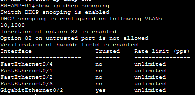
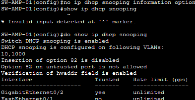
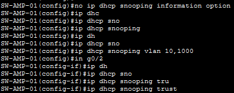

# 8. Incidencias y resolución de problemas

## 8.1 Objetivo

Este documento recoge las incidencias reales encontradas durante el desarrollo y validación del laboratorio, el proceso de diagnóstico seguido y la solución aplicada.

El objetivo no es solo dejar constancia de que el laboratorio funciona, sino documentar **cómo se llegó a la solución**, incluyendo los caminos descartados. En un entorno real, la capacidad de diagnosticar y documentar un fallo es tan importante como la configuración inicial.

Cada incidencia se documenta con la siguiente estructura:

- **Síntoma**: qué se observa.
- **Comprobaciones**: qué se revisó para acotar el problema.
- **Hipótesis descartadas**: qué se probó y no era la causa.
- **Causa**: el origen real del fallo.
- **Solución**: qué se cambió.
- **Aprendizaje**: qué se extrae para futuras configuraciones.

---

## 8.2 Incidencia 1 — DHCP deja de funcionar en Amposta al activar DHCP Snooping

### Síntoma

Al entrar en el laboratorio, los clientes de la sede de Amposta (`192.168.10.0/24`, VLAN 10) dejaron de recibir direccionamiento IP.

El servicio DHCP funcionaba con normalidad antes de configurar los mecanismos de seguridad de capa 2. El fallo apareció después de habilitar DHCP Snooping en `SW-AMP-01`.

### Comprobaciones iniciales

Se revisó, en este orden:

1. **Conectividad física y estado de interfaces en `SW-AMP-01`:**

   ```text
   show interfaces status
   ```

   Los puertos `Fa0/1`–`Fa0/4` aparecían `connected` en VLAN 10, y `Gi0/2` en estado `trunk`. No había puertos en `err-disabled`.

2. **Estado del trunk:**

   ```text
   show interfaces trunk
   ```

   `Gi0/2` aparecía como `802.1q`, `trunking`, con las VLAN 1, 10 y 1000 activas.

3. **Configuración del router `RTR-AMP`:**

   Se comprobó que la interfaz hacia el switch tenía la IP de gateway de la LAN.

4. **Estado de DHCP Snooping:**

   ```text
   show ip dhcp snooping
   show ip dhcp snooping binding
   ```

   DHCP Snooping estaba habilitado para las VLAN 10 y 1000, `Gi0/2` marcado como `Trusted`, y la tabla de bindings vacía (`Total number of bindings: 0`).

   

### Hipótesis descartadas

Antes de encontrar la causa real, se probaron dos cambios que **no resolvieron el problema**, pero que se mantuvieron por coherencia con el diseño:

1. **VLAN nativa del trunk hacia el router.**

   Se probó a cambiar la VLAN nativa del trunk a la VLAN 10, pensando que el router podría estar esperando tráfico sin etiquetar. No era la causa.

2. **Subinterfaz en `RTR-AMP` para la VLAN 10.**

   Se dejó configurada una subinterfaz `Gi0/2.10` con `encapsulation dot1Q 10`, de forma que el router desetiqueta la VLAN 10 y se facilita una futura ampliación a más subredes.

   Tampoco era la causa del fallo de DHCP, pero se mantuvo por diseño.

Estos dos cambios son válidos y forman parte de la configuración actual, pero no explicaban el fallo. **Descartarlos fue clave para seguir buscando en la capa correcta.**

### Causa

La salida de `show ip dhcp snooping` mostraba:

```text
Insertion of option 82 is enabled
Option 82 on untrusted port is not allowed
```

DHCP Snooping estaba insertando **Option 82** en las peticiones DHCP que atravesaban el switch. El servidor DHCP de la sede es `RTR-AMP` (router Cisco IOS en Packet Tracer), que **no procesa correctamente la opción 82** y descarta las peticiones. Por eso el cliente no recibía respuesta, aunque el puerto del servidor estuviera marcado como `Trusted`.

El fallo no era de confianza de puertos ni de trunk: era de una opción que el servidor no sabía interpretar en el entorno simulado.

### Solución

**Paso 1 — Deshabilitar Option 82 antes de reconfigurar DHCP Snooping.**

Se deshabilitó la inserción automática de Option 82:

```text
configure terminal
no ip dhcp snooping information option
end
```

**Verificación:**

```text
show ip dhcp snooping
```

La salida confirmó que Option 82 ya no se insertaba.



**Paso 2 — Reiniciar el proceso de DHCP Snooping desde cero.**

Tras deshabilitar Option 82, el DHCP seguía sin funcionar. Packet Tracer había quedado con un estado inconsistente, así que se optó por retirar la configuración de snooping y volver a aplicarla en el orden correcto.

Primero, se eliminó la configuración existente:

```text
configure terminal
no ip dhcp snooping
no ip dhcp snooping vlan 10,1000
interface GigabitEthernet0/2
 no ip dhcp snooping trust
end
```

A continuación, se volvió a aplicar la configuración:

```text
configure terminal
no ip dhcp snooping information option
ip dhcp snooping
ip dhcp snooping vlan 10,1000
interface GigabitEthernet0/2
 ip dhcp snooping trust
end
```

**Paso 3 — Renovar la IP en el cliente.**

Por último, se renovó la configuración IP del cliente para forzar una nueva solicitud DHCP:

```text
ipconfig /release
ipconfig /renew
```

El cliente recibió IP correctamente y la tabla de bindings empezó a registrar entradas.



### Resultado

- Los clientes de la VLAN 10 reciben IP de nuevo.
- La tabla de bindings de DHCP Snooping registra entradas.
- DAI pasa a operar con información real, ya que depende de los bindings de DHCP Snooping.

### Aprendizaje

1. **El orden de configuración importa.** En DHCP Snooping conviene deshabilitar Option 82 **antes** de habilitar el snooping por VLAN y marcar los puertos `trusted`.

2. **Option 82 requiere soporte del servidor DHCP.** En entornos reales es útil para identificar el puerto de origen, pero si el servidor no lo procesa, las peticiones se descartan.

3. **Descartar hipótesis es parte del diagnóstico.** Probar el cambio de VLAN nativa y la subinterfaz no era la solución, pero permitió acotar el problema y dejar una configuración más limpia.

4. **Packet Tracer no siempre refleja el comportamiento de un equipo real.** Un estado inconsistente puede requerir reaplicar la configuración desde cero, no solo cambiar un comando.

5. **Documentar el proceso, no solo el resultado.** Esta incidencia es un ejemplo de troubleshooting de capa 2 con síntoma, comprobaciones, hipótesis descartadas, causa y solución.
